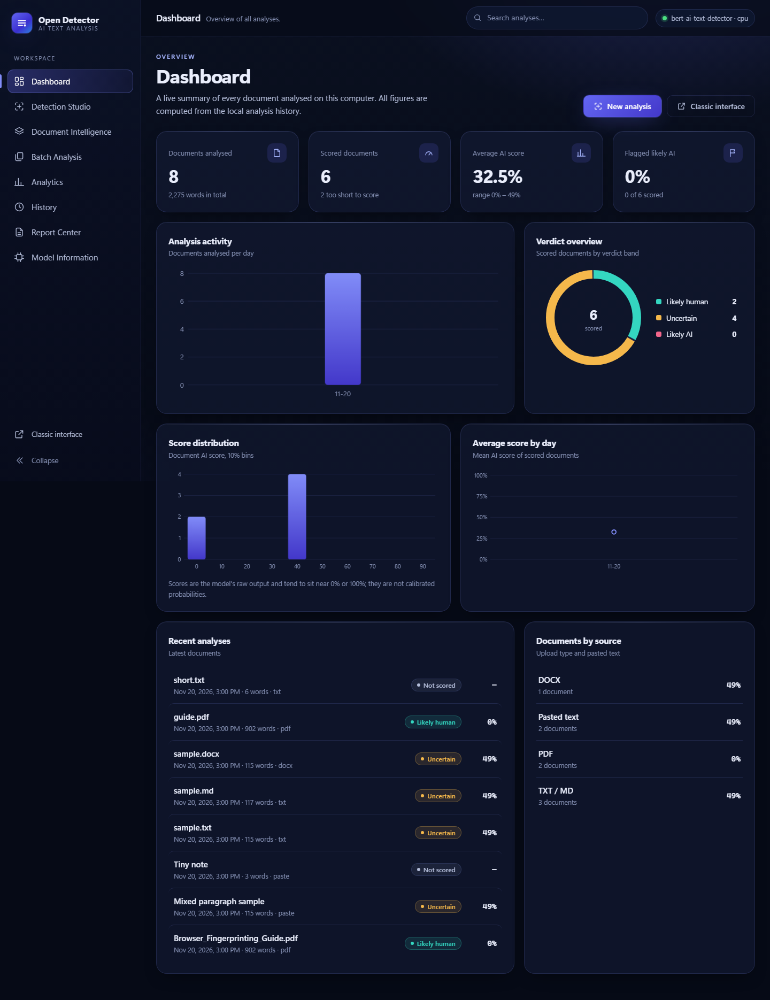
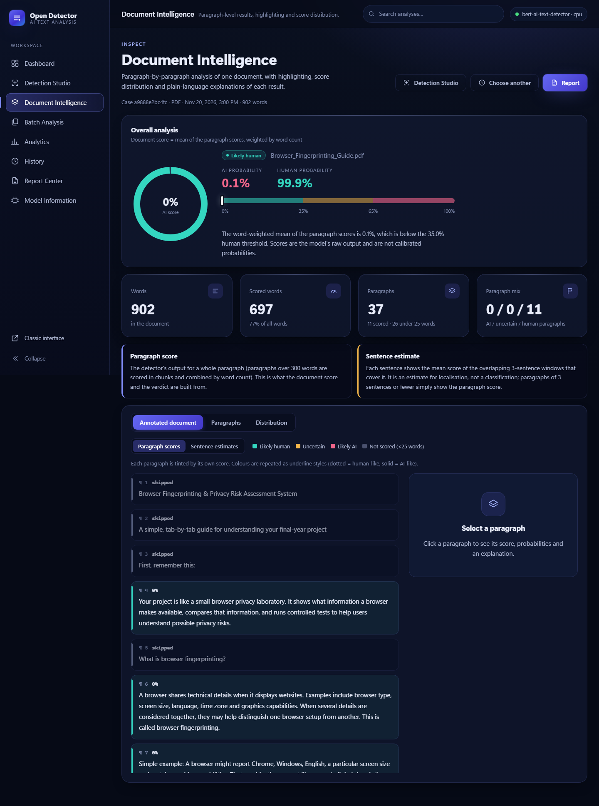
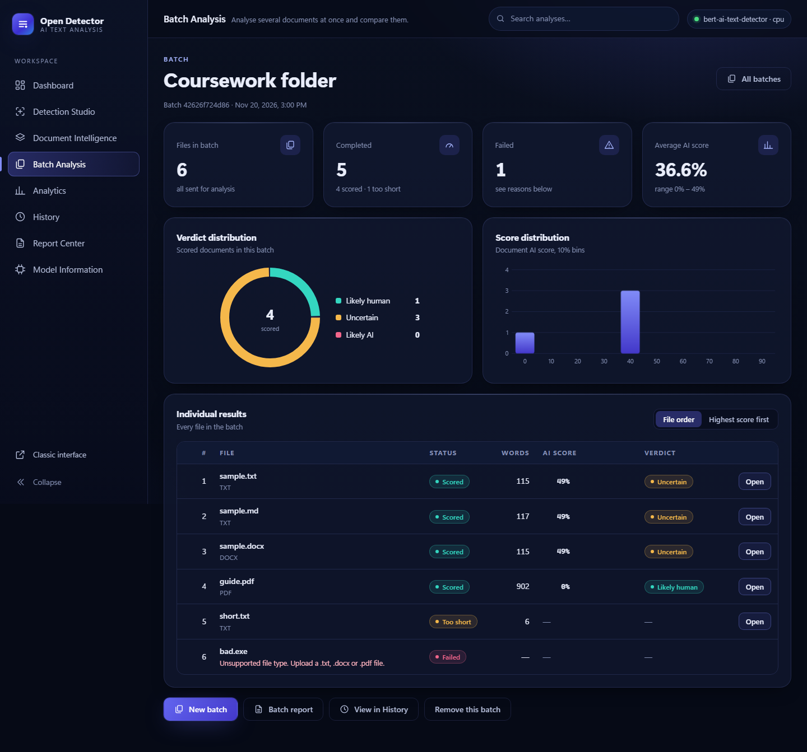
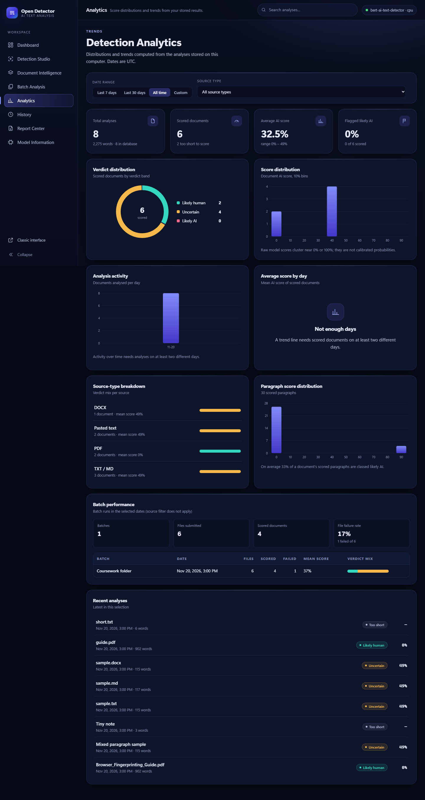

# Open Detector: local AI-text detection with two independent models

<div align="center">


**Language / 语言**: [English](README_EN.md) | [中文](README_ZH.md)
*(The translated READMEs and parts of `docs/ARCHITECTURE.md` and `PROTOTYPE.md` predate the dual-model work and describe a single model.)*

</div>

**Open Detector** is a local web application that estimates whether a text is closer to human or AI writing style. It runs
entirely on your own computer (CPU only; nothing is uploaded). It originated as an open alternative to commercial detectors, built
around the `followsci/bert-ai-text-detector` model, and now can also run a second model, `fakespot-ai/roberta-base-ai-text-detection-v1`,
on the same input and show the two results side by side.

> **Read this first.** Open Detector is an **academic prototype**. It does **not** reliably identify AI-generated text.
> Measured recall on modern assistant-style writing is low for simple-English, conversational and technical text, and neither model
> flags mixed human/AI documents reliably (see [Known weaknesses](#known-weaknesses)). A score is a statistical signal about writing
> style, never proof of authorship.


## Contents
[Key features](#key-features) · [Dual-model architecture](#dual-model-architecture) · [Inputs and workflow](#supported-inputs-and-workflow) ·
[Side-by-side results](#side-by-side-results-and-thresholds) · [Install and run](#install-and-run-windows-powershell) ·
[Project architecture](#project-architecture) · [API](#api-endpoints) · [Frontend modules](#frontend-modules) · [Models and licences](#models-licences-and-local-cache) ·
[Evaluation](#evaluation) · [Known weaknesses](#known-weaknesses) · [Limitations and responsible use](#limitations-and-responsible-use) ·
[Roadmap](#roadmap-planned-not-implemented) · [Upstream model and credits](#upstream-model-and-credits) · [Licence](#licence)

## Key features
- **Local and private:** FastAPI backend, SQLite history, a plain HTML/CSS/JavaScript interface (no build step, no external assets).
- **Many input types:** pasted text, `.txt`, `.md`, `.docx` and text-based `.pdf`, plus batch analysis of up to 20 files.
- **Paragraph-level analysis:** paragraph scores, sentence context-window estimates for highlighting, document score, plain-language explanations.
- **Dual-model comparison (new):** Followsci BERT and Fakespot RoBERTa on identical input, each with its own validated thresholds,
  probabilities, verdict and inference time, with agreement and disagreement highlighted per paragraph and per document.
- **History, analytics and print-ready reports** computed from your stored analyses; the original interface remains available at `/classic`.
- **Reproducible evaluation** scripts and datasets; every reported number is generated by a script in `evaluation/`.

## Dual-model architecture

| | Followsci BERT | Fakespot RoBERTa |
|---|---|---|
| Hugging Face id | `followsci/bert-ai-text-detector` | `fakespot-ai/roberta-base-ai-text-detection-v1` |
| Base model / size | `bert-base-uncased`, 109.5 M parameters | `roberta-base`, 124.6 M parameters |
| Labels | 0 = human, 1 = AI | 0 = human, 1 = AI (checked when the model loads) |
| Where it is used | Everywhere in the app (original behaviour, unchanged) | Only the dual-model page and its API (`#/dual`) |
| Loading | At server start | On the first dual request, from the local cache only |

Rules the implementation follows (`detector/dual.py`, `app/dual_api.py`, [docs/DUAL_MODEL.md](docs/DUAL_MODEL.md)):
- Both models score the **same normalised text** through the **existing** `analyze_document` (same extraction, segmentation, chunking), so paragraphs line up one to one.
- **No averaging of probabilities and no combined verdict.** Each model decides alone. The comparison only labels agreement.
- **Failures are independent.** If one model cannot load or run, its block shows an error and the other result is still returned.
- **Existing features are untouched.** Detection Studio, History, Batch, Analytics, Reports, `/classic` and all earlier endpoints use only Followsci with its shipped verdict bands. Dual results are returned to the caller and are **not** saved to history.

## Supported inputs and workflow

Supported inputs: pasted text, `.txt`, `.md`, `.docx`, and text-based `.pdf` (scanned PDFs without selectable text cannot be read). Files up to 10 MB;
at least 40 words are needed for a result.

Workflow (every route ends in the same analysis code; the browser never scores anything):
1. **Extract** text (`app/extract.py`). PDFs get paragraph reconstruction: running headers, footers and page numbers repeated across pages are removed and sentences split by a page break are re-joined. Known minor flaw: a single-page PDF keeps its running header (the header is short and is not scored).
2. **Segment** into paragraphs and sentences (`detector/segmentation.py`); documents over 20,000 words are truncated and flagged.
3. **Score** each paragraph of at least 25 words (paragraphs over 300 words in chunks) with the model, label 0 = human, 1 = AI, 512-token limit. Shorter paragraphs are not scored, so a document with many short paragraphs or table-like blocks may be only partly covered (in the repository's guide-PDF fixture, 11 of 37 paragraphs were scored).
4. **Estimate sentences:** overlapping 3-sentence windows give context-window estimates, used only for highlighting.
5. **Aggregate:** the document score is the word-weighted mean of paragraph scores of *one* model.
6. **Verdict:** the model's own thresholds are applied (below).

## Side-by-side results and thresholds

The dual-model page (`#/dual`, sidebar footer "Dual-model compare") shows for each model: AI probability, human probability, verdict, inference time,
its thresholds and whether they were validated, the share of paragraphs flagged AI, and licence/device. For Followsci it also shows the verdict the
existing app gives for the same text. Below the two cards, a paragraph table compares both models paragraph by paragraph, with a filter for disagreements.

Agreement labels (per paragraph and for the document): **Both: AI**, **Both: human**, **Both: uncertain**, **One uncertain**, **Disagree**, **Not compared**.
The page also shows the difference in AI probability between the models; it never merges them into one number.

**Independent thresholds.** `evaluation/dual_eval.py` splits the evaluation set 50/50 (seed 13, stratified) into validation and test halves and chooses each
model's thresholds on the validation half only: *AI at or above* = the lowest score with validation false-positive rate at most 5%; *human below* = the highest
score that still keeps at least 95% of validation AI texts above it; in between is *uncertain*. The values are stored in `detector/thresholds.json` (if the file is missing the page shows "not validated (defaults)").

| Model | Likely human if P(AI) below | Likely AI if P(AI) at or above | Share of test texts left "uncertain" |
|---|---|---|---|
| Followsci BERT | 0.000002128 | 0.9927 | 71.0% |
| Fakespot RoBERTa | 0.4333 | 0.9941 | 18.6% |

Followsci's scores are so extreme that a 5% false-positive limit leaves it "uncertain" for most texts. This is why its verdict in the dual view can differ from
the existing app's verdict (bands 0.35 / 0.65, shown alongside).

## Install and run (Windows PowerShell)

Requirements: Windows 10/11, Python 3.11, CPU only (no GPU needed). Measured memory on the development machine: the server uses about **0.83 GB** with Followsci only and
about **1.4 GB** with both models loaded. The Hugging Face cache holds about 418 MB (Followsci) and 481 MB (Fakespot).

```powershell
cd Open-Detector
python -m venv .venv
.\.venv\Scripts\Activate.ps1
pip install torch --index-url https://download.pytorch.org/whl/cpu
pip install -r requirements.txt
.\run.ps1                       # then open http://127.0.0.1:8000
```

- **Followsci** downloads automatically from Hugging Face on first start and is cached.
- **Fakespot is loaded from the local cache only (it is never downloaded by the app).** To enable the dual-model page, cache it once while online:
  `.\.venv\Scripts\hf.exe download fakespot-ai/roberta-base-ai-text-detection-v1`
  (the command syntax was checked with `--help`; it was not run in this documentation pass because the model is already cached on the development machine).
  If Fakespot is not cached, the dual-model page reports an error for that model; the rest of the application is unaffected.
- `run.ps1` starts the server at `http://127.0.0.1:8000`: new interface at `/`, original interface at `/classic`, API documentation at `/api/docs`.
- **Port 8000 in use?** Run `.\.venv\Scripts\python.exe -m uvicorn app.main:app --host 127.0.0.1 --port 8765`. `GET /api/status` identifies an Open Detector server.
- Terminal scoring (Followsci only): `.\.venv\Scripts\python.exe -m detector.cli path\to\file.txt`
- Data is stored in `data/history.db` on your computer (override with the `OPEN_DETECTOR_DB` environment variable).

```powershell
.\.venv\Scripts\python.exe -m pytest tests -q     # backend and frontend-logic tests
.\tests\e2e\run_e2e.ps1                            # real-browser checks (needs Node 22+ and Chrome)
```
Last full pytest run on the development machine (2026-11-21): 145 passed, 1 expected failure (`tests/test_pdf_guide_fixture.py`, a recorded known weakness; see below). The browser checks were not part of that run.

## Project architecture

```
Browser (vanilla JS single-page app, no build step)    /  new interface     /classic  original interface
        |  JSON / multipart
FastAPI  app/main.py        analyse, upload, history, reports (original API) + router includes
         app/extra_api.py   stats, search, batch, model info
         app/dual_api.py    dual-model endpoints (additive)
         app/extract.py     TXT / MD / DOCX / PDF -> text      app/history.py  SQLite      app/reports.py  HTML report
detector/  segmentation.py -> analysis.py (paragraph scoring, aggregation) -> model.py (Followsci) | dual.py (Fakespot + dual analysis)
data/history.db            evaluation/ (scripts, datasets, results)
```

| Path | Contents |
|---|---|
| `app/` | FastAPI backend; `app/static/` holds the original interface (`index.html`, `app.js`, `styles.css`) and the new one in `app/static/v2/` |
| `detector/` | `model.py` (Followsci), `dual.py` (Fakespot loader, per-model thresholds, dual analysis, agreement), `thresholds.json`, `segmentation.py`, `analysis.py`, `cli.py` |
| `evaluation/` | `collect_data.py`, `evaluate.py` (Followsci on HC3/MAGE), `dual_eval.py` (both models, validation/test split), `data/`, `results/` |
| `evaluation/indomain/` | In-domain dataset and evaluation: `collect_human.py`, `build_dataset.py`, `eval_indomain.py`, `dataset.jsonl`, `mixed_docs.jsonl`, `results/`, its own `README.md` |
| `tests/` | pytest suite (including `test_dual.py`) and `tests/e2e/` browser scripts |
| `docs/` | `ARCHITECTURE.md` (single-model era; still accurate for the original app), `DUAL_MODEL.md` |
| `images/` | Screenshots (taken before the dual-model page was added) and upstream figures |

Every input route ends in `detector.analyze_document()`. Reports and analytics are built from results stored in SQLite. More detail: [docs/ARCHITECTURE.md](docs/ARCHITECTURE.md).

## API endpoints

Interactive documentation at `/api/docs`. Errors are JSON `{"detail": "..."}`. The list below was read from the running application's OpenAPI schema.

| Endpoint | Purpose |
|---|---|
| `GET /api/status` | Followsci model name, device, verdict bands, minimum word count |
| `POST /api/analyze` | `{text, title?}`: analyse pasted text with Followsci; stored in history |
| `POST /api/analyze-file` | multipart `file` (PDF, DOCX, TXT, MD; up to 10 MB); stored in history |
| `GET /api/history` · `GET /api/history/search` | List; search, filter, sort, paginate |
| `GET /api/history/{id}` · `DELETE /api/history/{id}` · `DELETE /api/history` | Read one, delete one, clear all |
| `GET /api/stats` | Dashboard and analytics aggregates (optional date and source filters) |
| `GET/POST /api/batch` · `GET/DELETE /api/batch/{id}` | Batch analysis (up to 20 files), list, detail, remove grouping |
| `GET /api/report/{id}.html` · `GET /api/report/{id}.json` | Report for a stored analysis |
| `GET /api/model-info` · `GET /api/evaluation` | Model facts; the HC3/MAGE metrics file |
| `GET /api/dual/status` | Both models: loaded or not, thresholds, licence, parameters, server memory |
| `POST /api/analyze-dual` | `{text, title?}`: both models on identical text; **not** stored in history |
| `POST /api/analyze-file-dual` | multipart `file`: same for an uploaded file; **not** stored in history |
| `GET /` · `GET /classic` | New interface; original interface |

The dual endpoints return, per model: `status` (`ok`, `insufficient_text` or `error`), `error`, `inference_ms`, `document` (`p_ai`, `p_human`, `verdict`, `ai_paragraph_share`, and for Followsci `shipped_verdict`),
`paragraphs`, `thresholds` and `card` (licence and base model); plus a `comparison` object (agreement labels, no combined score or verdict) and server `memory_mb`.

## Frontend modules

| Module | Route | Purpose |
|---|---|---|
| Dashboard | `#/dashboard` | Totals, verdict mix, activity, score distribution, recent analyses |
| Detection Studio | `#/studio` | Paste or upload, analyse with Followsci, probabilities and verdict |
| Document Intelligence | `#/intelligence` | Paragraph results, highlighting, sentence context-window estimates, explanations |
| Batch Analysis | `#/batch` | Up to 20 files, per-file status and failure reasons, combined overview |
| History | `#/history` | Search, filter, sort, paginate, open, delete |
| Analytics | `#/analytics` | Distributions, trends, source breakdown, batch performance |
| Report Center | `#/reports` | Print-ready reports (browser Print, Save as PDF) |
| Model Information | `#/model` | Model facts, scoring pipeline, measured HC3/MAGE metrics, weaknesses |
| **Dual-model comparison** | `#/dual` | Followsci and Fakespot side by side (linked from the sidebar footer; an extra route outside the eight modules) |

| | |
|---|---|
|  |  |
|  |  |

*Screenshots show analyses of small sample documents and predate the dual-model page. They illustrate the interface, not accuracy. More:
[History](images/ui/04-history.png) · [Report](images/ui/06-report.png) · [Model Information](images/ui/07-model-information.png) ·
[Detection Studio](images/ui/09-detection-studio.png) · [Mobile](images/ui/08-mobile-dashboard.png).*

## Models, licences and local cache

| | Followsci BERT | Fakespot RoBERTa |
|---|---|---|
| Model licence (from the Hugging Face model card, checked 2026-11-21) | MIT | Apache-2.0 |
| Training data (model card) | Arxiv academic papers versus LLM text; about 1.4 million training paragraphs | Not stated on the card |
| Intended use / caveats (model card) | Academic integrity research tool; not the sole basis for misconduct decisions; degrades on casual text, technical documentation and creative writing | Score is a likelihood, not the share of AI text; longer inputs are more accurate |
| Accuracy figures | Self-reported on its own unreleased split (see [Upstream model](#upstream-model-and-credits)); **not reproduced here** | None on the card |
| How it is loaded | `from_pretrained` (downloads on first use) | `from_pretrained(local_files_only=True)` (must already be cached) |
| Where the cache lives | `%USERPROFILE%\.cache\huggingface\hub` | same |

Fakespot's card suggests a `clean_text` preprocessing helper. It is deliberately **not** applied, so both models receive identical input.
The licences above were read from the model pages and are not re-checked at runtime. Verify them yourself before redistributing anything.
Both licences are declared in the metadata header of each Hugging Face model card (`license: mit` and `license: apache-2.0`); **neither model repository contains a separate `LICENSE` or `NOTICE` file**, and neither card names a copyright holder. The declarations were verified on 2026-11-21 (the absence of a separate licence file was re-confirmed on 2026-11-23). This repository does not bundle or redistribute either model's weights: they are downloaded or read from the local Hugging Face cache at run time.

Measured speed and memory (development machine, 12 logical cores, CPU only, idle; one run each, so indicative only): loading Fakespot took about 1.4 s and added about 0.57 GB;
one 90-word paragraph took about 0.7 s per model, about 900 words 4.5 to 4.8 s per model, about 2,600 words 14 to 15 s per model. The two models run one after the other, so dual time is roughly their sum.

## Evaluation

**Methodology.** Nothing is tuned on a test set. Thresholds are chosen on a validation split and measured on a separate test split (the in-domain dataset additionally splits by topic).
Metrics reported: accuracy, precision, recall, F1, AUROC, false-positive rate (FPR), false-negative rate and confusion matrices. Positive class = AI. Scripts:

```powershell
.\.venv\Scripts\python.exe evaluation\evaluate.py                 # Followsci on HC3 + MAGE (scores cached in evaluation/results/)
.\.venv\Scripts\python.exe evaluation\dual_eval.py                # both models, validation/test split, writes detector\thresholds.json
.\.venv\Scripts\python.exe evaluation\indomain\eval_indomain.py   # both models on the in-domain set (needs evaluation\indomain\dataset.jsonl)
```
Rebuilding data needs network access (`evaluation/collect_data.py`, `evaluation/indomain/collect_human.py`); the datasets are already in the repository. Scoring the full HC3/MAGE set with Fakespot took roughly 40 minutes or more on the development CPU; scores are cached.

### 1. Public benchmarks (out of domain): HC3 and MAGE

These are measured results. HC3 (CC-BY-SA-4.0) is human answers versus 2023 ChatGPT; MAGE (Apache-2.0) is human text versus many LLMs. Neither is educational writing from modern assistants.

Followsci at the plain 0.5 threshold, 3,300 texts (`evaluation/results/metrics.json`, also shown on the Model Information page):

| Dataset | n | Accuracy | Precision | Recall | F1 | AUROC | FPR |
|---|---|---|---|---|---|---|---|
| HC3 | 2,000 | 76.7% | 86.7% | 63.1% | 73.0% | 0.884 | 9.7% |
| MAGE | 1,000 | 51.2% | 58.3% | 8.4% | 14.7% | 0.536 | 6.0% |
| MAGE-OOD (unseen LLM) | 300 | 63.0% | 85.5% | 31.3% | 45.9% | 0.779 | 5.3% |
| All combined | 3,300 | 67.7% | 84.2% | 43.6% | 57.5% | 0.768 | 8.2% |

Both models, held-out **test half** (n = 1,653), each with its own validated thresholds (`evaluation/results/dual_report.md`):

| Model | Accuracy | Precision | Recall | F1 | AUROC | FPR | FNR |
|---|---|---|---|---|---|---|---|
| Followsci BERT | 65.5% | 90.3% | 34.7% | 50.2% | 78.1% | 3.7% | 65.3% |
| Fakespot RoBERTa | 90.7% | 94.8% | 86.1% | 90.2% | 95.8% | 4.7% | 13.9% |

| Test subset | Followsci recall / FPR / AUROC | Fakespot recall / FPR / AUROC |
|---|---|---|
| HC3 | 50.2% / 5.2% / 89.3% | 98.2% / 2.4% / 99.6% |
| MAGE | 6.8% / 2.0% / 55.9% | 58.0% / 6.0% / 82.9% |
| MAGE-OOD | 25.0% / 0.0% / 77.6% | 98.7% / 15.8% / 98.7% |

At the default 0.5 cut-off on the same test half, Fakespot's FPR was 30.1% (recall 95.6%); Followsci's was 8.1% (recall 44.9%). The Phase-1 caveats apply: these datasets are not the target domain, the models' training data is not fully public (overlap cannot be excluded), and thresholds were chosen on about 1,650 texts.

### 2. In-domain dataset: educational and technical writing (236 texts)

Built to test the target use. Full details and provenance: [evaluation/indomain/README.md](evaluation/indomain/README.md).

| Style | Human text (all dated before 2022-06-01) | AI text (same topic) | n (human / AI) |
|---|---|---|---|
| Simple English | Simple English Wikipedia revisions | "explain simply for a beginner" | 36 / 36 |
| Formal | English Wikipedia revisions | formal encyclopedic paragraph | 36 / 36 |
| Technical | CPython 3.11 documentation text | Python-reference-style explanation | 21 / 21 |
| Conversational | Stack Exchange answers (cs, physics, biology) | friendly answer to the same question | 25 / 25 |

- **Labels:** each human text stores its source, revision or answer id and timestamp. All AI text was written by one assistant (Claude) for this purpose, with the prompt style recorded; none is copied from a source (maximum 8-gram overlap with its human counterpart 0.058).
- **Splits:** by topic, so both labels of a topic share a split: train 116, validation 46, **test 74**. Checks: 0 shared topics, 0 duplicate texts, maximum cross-split 8-gram overlap 0.007. The train split is **not used** by any evaluation or model; it is reserved for possible future work. Word count alone separates the classes at only 54.9% AUROC.
- **Mixed documents:** 56 documents of 4 paragraphs each (1 to 3 AI paragraphs), built inside each split.

Held-out test split (37 human, 37 AI). The 95% bootstrap intervals are wide, roughly 10 to 20 points:

| Model and operating point | Accuracy | Precision | Recall | F1 | AUROC | FPR |
|---|---|---|---|---|---|---|
| Followsci, default 0.5 | 63.5% | 91.7% | 29.7% | 44.9% | 65.9% | 2.7% |
| Followsci, Phase-1 thresholds | 62.2% | 90.9% | 27.0% | 41.7% | 65.9% | 2.7% |
| Fakespot, default 0.5 | 62.2% | 58.2% | 86.5% | 69.6% | 78.4% | 62.2% |
| Fakespot, Phase-1 thresholds | 71.6% | 83.3% | 54.1% | 65.6% | 78.4% | 10.8% |
| Fakespot, threshold re-selected on in-domain validation | 66.2% | 100% | 32.4% | 49.0% | 78.4% | 0.0% |

By style, using all 236 texts at fixed operating points (nothing is fitted there, so every split is valid; larger n):

| Style | Followsci AUROC / recall (Phase-1 thresholds) | Fakespot AUROC / recall (Phase-1 thresholds) | Fakespot FPR at default 0.5 |
|---|---|---|---|
| Formal | 95.8% / 72.2% | 93.4% / 86.1% | 47.2% |
| Simple English | 59.3% / 2.8% | 86.9% / 72.2% | 75.0% |
| Conversational | 59.4% / 0.0% | 77.1% / 32.0% | 52.0% |
| Technical | 52.8% / 4.8% | 53.5% / 4.8% | 71.4% |

On all 236 texts with Phase-1 thresholds, Followsci had recall 23.7% at FPR 2.5%, and Fakespot recall 55.9% at FPR 9.3% (11 of 118 human texts flagged as AI). A supplementary run of one other locally cached model (Oxidane RoBERTa) was not better (AUROC 73% overall and 31% on technical text); it is not part of the application.

Mixed human/AI documents through the real application pipeline (56 documents): with Phase-1 thresholds, the document verdict was "likely AI" for 0 of 56 documents with Followsci and 2 of 56 with Fakespot; the rest were "uncertain" or "likely human". Fakespot's mean document AI probability was 72 to 84%, which still falls in its uncertain band.

The repository's study-guide PDF fixture (reported by the project as AI-written; not independently verified, not part of the dataset): Followsci document score 0.1%, Fakespot 19.3%. Neither model flags it.

**Caveats of the in-domain data:** one AI generator family; human text is encyclopedic, documentation or forum prose, not student writing; small sample (118 per class); human technical paragraphs are mid-document excerpts while AI paragraphs are self-contained; no paraphrased or humanized text was tested.

## Known weaknesses

All of the following are measured on the datasets above, not assumptions.
- **Simple-English text:** Followsci recalls almost none of the AI text (2.8%). Fakespot catches more (72% at Phase-1 thresholds) but, at its default cut-off, flags 75% of human simple-English Wikipedia as AI: clear, simple definitions look like assistant output.
- **Conversational text:** Followsci recall 0%; Fakespot 32% at Phase-1 thresholds.
- **Technical text:** both models are close to chance (AUROC about 53%).
- **Mixed human/AI documents:** neither model reliably produces a document-level "likely AI" verdict when only some paragraphs are AI. Paragraph-level flags are the more informative output.
- **Formal, encyclopedic prose** is the one style handled well (AUROC 93 to 96%), which is closest to what the models were trained on. The public benchmarks also show weak recall on several generators (Followsci recall 8.4% on the full MAGE sample, 6.8% on its test half).
- **Scores are nearly binary** (about 90% of Followsci scores on HC3/MAGE are below 2% or above 98%), so a percentage is not a calibrated probability. Re-selecting a threshold on in-domain data did not improve results: the limitation is how well each model ranks AI above human text.
- **Not measured at all:** paraphrased or humanized AI text, non-native-English writing, student writing, other AI generators, very short texts (under about 80 words are known to be less reliable in the HC3/MAGE results).

## Limitations and responsible use
- This is **not** a reliable detector of all AI-generated text and should not be described as one. Both false positives (human text flagged) and false negatives (AI text missed) occur at measurable rates.
- A score is a probabilistic signal about writing style. It cannot prove or disprove who wrote a text. **Do not use it as the sole basis for an academic-integrity or disciplinary decision.**
- Plain-English educational writing is both a likely use case and a measured weak spot: human writing in that style can be flagged and AI writing in that style can be missed.
- Sentence highlighting is a context-window estimate, not a per-sentence classification. Only paragraphs of 25 or more words are scored.
- Results depend on the thresholds in `detector/thresholds.json`, which were chosen on out-of-domain data and should be re-validated on in-domain text before relying on them.
- Dual results are not stored in history. Batch analysis and reports use Followsci only.

## Roadmap (planned, not implemented)
None of the following exists yet.
- Expand the in-domain dataset to several thousand texts with several AI generators, real student writing and paraphrased text, and re-evaluate. The current in-domain train split (116 texts, one generator) is too small and too narrow to train on.
- Only after that, consider fine-tuning (Fakespot RoBERTa is the candidate). **No fine-tuned model has been produced or used**; the fine-tuning folders prepared outside this repository (`local_finetune`, `colab_finetune`) were not run to completion.
- Decide how Followsci's verdict should be presented in the dual view (validated thresholds versus the shipped bands).
- Better mixed-document reporting based on the share of flagged paragraphs; optionally store dual results in history.
- Bring `README_EN.md`, `README_ZH.md`, `docs/ARCHITECTURE.md` and `PROTOTYPE.md` in line with this README.
- Longer-term research directions from the upstream authors (fact-consistency checking, hallucination and fake-citation detection, more languages) are their aims and are not implemented here.

## Upstream model and credits

The Followsci model and the original repository are by the upstream authors; model files and card: <https://huggingface.co/followsci/bert-ai-text-detector>. The upstream authors also operate an
online platform (XYZ SCIENCE, <https://www.xyzscience.com/>); it is not part of this repository and was not evaluated here. This repository contains no text-rewriting or humanizer feature.

The second model used on the dual-model page is **`fakespot-ai/roberta-base-ai-text-detection-v1`** by Fakespot AI (Apache-2.0, base model `FacebookAI/roberta-base`); it is used unmodified.
Model card: <https://huggingface.co/fakespot-ai/roberta-base-ai-text-detection-v1>. Its card points to the ApolloDFT repository for the technical report and experiments:
<https://github.com/FakespotAILabs/ApolloDFT>. Fakespot AI and its authors are not affiliated with this project, and the accuracy of this model reported here is from our own evaluation only.

The model card reports, for its own unreleased in-domain academic test split, 99.57% accuracy, 99.58% F1, 99.94% recall and a 0.82% false-positive rate (figures below). They are the upstream authors' claims and have **not been reproduced** in this repository; our measurements on other data are much lower.


The original minimal usage of the upstream model is in `example_usage.py`:

```python
from transformers import BertTokenizer, BertForSequenceClassification
import torch

model_name = "followsci/bert-ai-text-detector"
tokenizer = BertTokenizer.from_pretrained(model_name)
model = BertForSequenceClassification.from_pretrained(model_name)
model.eval()

inputs = tokenizer("Your academic paragraph here...", return_tensors="pt", truncation=True, max_length=512)
with torch.no_grad():
    probs = torch.nn.functional.softmax(model(**inputs).logits, dim=-1)
print(f"AI: {probs[0][1].item() * 100:.1f}% | Human: {probs[0][0].item() * 100:.1f}%")   # labels: 0 = human, 1 = AI
```

The upstream README's background argues that detectors should focus on content authenticity and AI hallucination rather than writing style, and notes that this project is
currently **stylometric only**. That statement still applies here: the detector looks at style, not at whether content is true.

## Licence

The project is released under the MIT licence (see `LICENSE`). The models carry their own licences (Followsci: MIT; Fakespot: Apache-2.0, per their model cards). Evaluation data keeps its source licences:
HC3 CC-BY-SA-4.0, MAGE Apache-2.0, Wikipedia text CC BY-SA 3.0/4.0, Stack Exchange answers CC BY-SA, CPython documentation PSF. Share-alike applies to derived datasets; cite the sources if you redistribute them.
