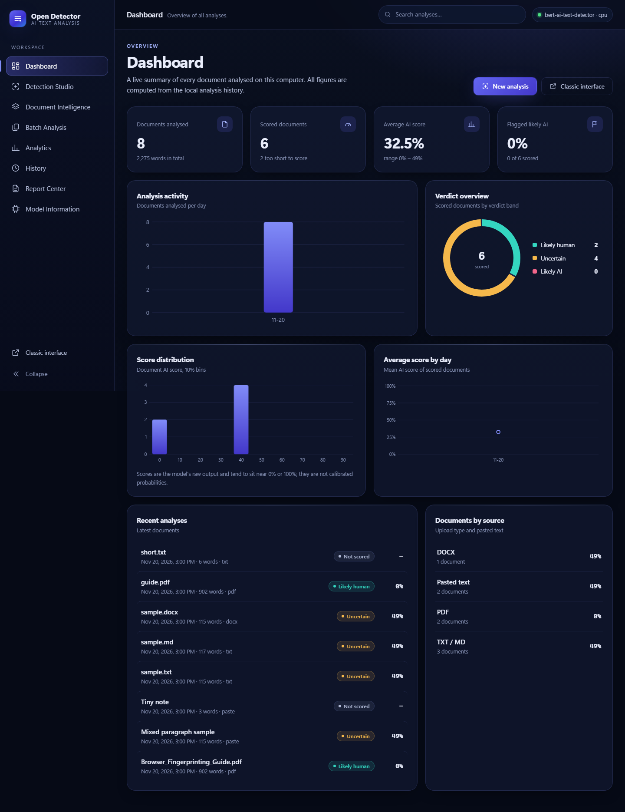
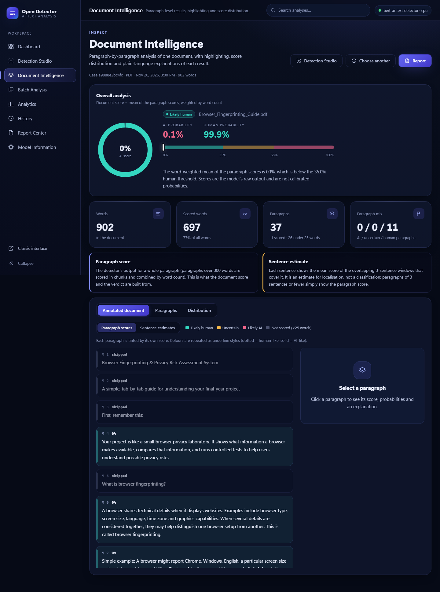
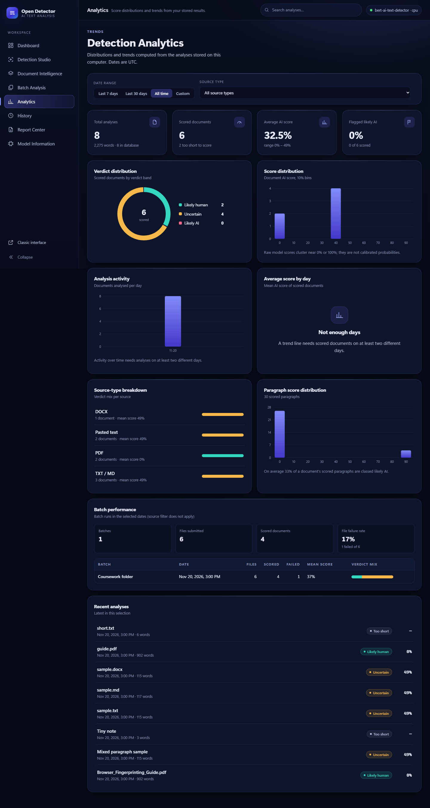

# 🧠 Open Detector —— Academic Paper AI Detector

<div align="center">


**Language / 语言**: [English](README_EN.md) | [中文](README_ZH.md)

</div>

**Open Detector** is a BERT binary classification model for identifying whether academic papers are closer to **human writing** or **AI writing style**. It serves as an **open alternative** to expensive commercial detectors like Turnitin, suitable for students, individual researchers, and local deployment users. This repository also packages it as a local web application that can run a second detector (Fakespot RoBERTa) alongside it; see below.


## 🖥️ Open Detector Web Application (final-year academic prototype)

This repository also contains a complete **local web application**: you analyse documents on your own computer, nothing is
uploaded anywhere. It adds a FastAPI backend, a SQLite history and an eight-module interface written in plain
HTML/CSS/JavaScript (no build step, no external assets), plus a **dual-model comparison page** that runs two independent
detectors, **Followsci BERT** (the original model) and **Fakespot RoBERTa**, on the same input. The original Followsci
detector code and scoring are unchanged and the original interface is still available at `/classic`. The main
[README.md](README.md) has the full, current description; this file mirrors it together with the upstream sections below.

> **Read this first.** Open Detector is an academic prototype. It does **not** reliably identify AI-generated text.
> Measured recall on modern assistant-style writing is low for simple-English, conversational and technical text, and neither
> model flags mixed human/AI documents reliably (see the weaknesses below). A score is a statistical signal about writing
> style, never proof of authorship.

| | |
|---|---|
|  |  |
|  |  |

*Screenshots show real analyses of small sample documents made on a development machine; they predate the dual-model page. They
illustrate the interface, not the models' accuracy; see the evaluation below. More: [History](images/ui/04-history.png) ·
[Report](images/ui/06-report.png) · [Model Information](images/ui/07-model-information.png) ·
[Detection Studio](images/ui/09-detection-studio.png) · [Mobile](images/ui/08-mobile-dashboard.png).*

### Modules

| Module | Purpose |
|---|---|
| **Dashboard** | Totals, AI/human/uncertain verdict mix, activity over time, score distribution, recent analyses (all computed from your stored analyses) |
| **Detection Studio** | Paste text or drag-and-drop a file; word/character counts, validation, progress; AI and human probability, verdict and statistics (Followsci) |
| **Document Intelligence** | Paragraph-by-paragraph results, highlighting, score distributions and plain-language explanations; clearly separates *paragraph scores* from *sentence context-window estimates* |
| **Batch Analysis** | Up to 20 files at once, per-file status and failure reasons, combined overview, previous batches |
| **History** | Search by name; filter by verdict, source, status and date; sort; paginate; open or delete (with confirmation) |
| **Analytics** | Distributions, trends, source-type breakdown and batch performance with date and source filters |
| **Report Center** | Print-ready reports for any analysis or batch; use the browser's **Print → Save as PDF** |
| **Model Information** | Model facts read from the loaded model, how scoring works, measured metrics and datasets, known weaknesses |
| **Dual-model comparison** (`#/dual`) | Followsci BERT and Fakespot RoBERTa side by side on the same text; linked from the sidebar footer (an extra route outside the eight modules) |

### Dual-model detection

| | Followsci BERT | Fakespot RoBERTa |
|---|---|---|
| Hugging Face id | `followsci/bert-ai-text-detector` | `fakespot-ai/roberta-base-ai-text-detection-v1` |
| Base model / parameters | `bert-base-uncased`, 109.5 M | `roberta-base`, 124.6 M |
| Licence (model card) | MIT | Apache-2.0 |
| Used by | the whole app (unchanged behaviour) | only the dual-model page and its API |
| Loading | at server start; downloaded on first use | on the first dual request, **from the local cache only** |

* Both models score the same normalised text through the existing `analyze_document`, so paragraphs line up one to one.
* **Each model decides independently with its own thresholds. Probabilities are never averaged and there is no combined verdict.**
  The page only labels agreement per paragraph and for the document: *Both: AI*, *Both: human*, *Both: uncertain*, *One uncertain*, *Disagree*.
* A model that fails to load or run shows an error in its own block; the other result is still returned.
* Dual results are not saved to history. Detection Studio, History, Batch, Analytics and Reports use Followsci only.
* **Thresholds** are chosen per model on a validation split and measured on a separate test split (`evaluation/dual_eval.py`, stored in
  `detector/thresholds.json`): *AI* = lowest score with validation false-positive rate at most 5%; *human* = highest score keeping at least 95% of validation AI texts above it.

| Model | Likely human if P(AI) below | Likely AI if P(AI) at or above | Test texts left "uncertain" |
|---|---|---|---|
| Followsci BERT | 0.000002128 | 0.9927 | 71.0% |
| Fakespot RoBERTa | 0.4333 | 0.9941 | 18.6% |

For Followsci the page also shows the verdict the existing app gives for the same text (bands 0.35 / 0.65), which can differ from the validated-threshold verdict.
Details: [docs/DUAL_MODEL.md](docs/DUAL_MODEL.md) and [docs/ARCHITECTURE.md](docs/ARCHITECTURE.md).

### Install and run (Windows)

Requirements: Windows 10/11, Python 3.11, CPU only (no GPU needed). Measured server memory: about 0.83 GB with Followsci only and about 1.4 GB with
both models loaded. The Hugging Face cache holds about 418 MB (Followsci) and 481 MB (Fakespot).

```powershell
cd Open-Detector
python -m venv .venv
.\.venv\Scripts\Activate.ps1
pip install torch --index-url https://download.pytorch.org/whl/cpu
pip install -r requirements.txt
.\run.ps1                       # then open http://127.0.0.1:8000
```

`run.ps1` starts the server on `http://127.0.0.1:8000`: the new interface is at `/`, the original at `/classic`, the API
documentation at `/api/docs`. Pinned versions are in `requirements.txt` (the project was developed and tested with Python 3.11).
Followsci downloads automatically on first start. **Fakespot is never downloaded by the app**: to enable the dual-model page, cache it once while
online with `.\.venv\Scripts\hf.exe download fakespot-ai/roberta-base-ai-text-detection-v1`. If it is not cached, the dual page shows an error for that model and the rest of the app is unaffected.

### Using it

* **Supported inputs:** pasted text, `.txt`, `.md`, `.docx` and text-based `.pdf` (scanned PDFs without selectable text
  cannot be read). Files up to 10 MB; at least 40 words are needed for a result.
* **Analyse one document:** *Detection Studio* → paste or drop a file → *Run analysis* → *Open Document Intelligence*.
* **Compare both models:** open *Dual-model compare* (`#/dual`) → paste text or choose a file → *Compare both models*.
* **Analyse many:** *Batch Analysis* → drop several files → *Analyse batch*. A file that cannot be read fails alone; the
  rest are analysed. Results are also saved in History.
* **Create a report:** *Report Center* (or the *Report* button on any result) → *Print / Save as PDF*.
* Data is stored in `data/history.db` on your computer; delete analyses in *History* or remove the file.

### Tests

```powershell
.\.venv\Scripts\python.exe -m pytest tests -q          # backend + frontend logic tests (incl. tests/test_dual.py)
.\tests\e2e\run_e2e.ps1                                 # real-browser checks (needs Node 22+ and Chrome)
```
Last full pytest run (2026-11-21): 145 passed, 1 expected failure (`tests/test_pdf_guide_fixture.py`, a recorded known weakness). The browser checks were not part of that run.

### Evaluation, datasets and known limitations (our own measurements)

`evaluation/` contains reproducible scripts and results; the application reads `evaluation/results/metrics.json`, so its Model Information
page and the first table below are the same numbers. Positive class = AI. Thresholds are never tuned on a test set.

**1. Public benchmarks (out of domain): HC3 and MAGE.** Followsci at a plain 0.5 threshold (`evaluate.py`):

| Dataset | n | Accuracy | Precision | Recall | F1 | AUROC | False-positive rate |
|---|---|---|---|---|---|---|---|
| HC3 | 2,000 | 76.7% | 86.7% | 63.1% | 73.0% | 0.884 | 9.7% |
| MAGE | 1,000 | 51.2% | 58.3% | 8.4% | 14.7% | 0.536 | 6.0% |
| MAGE-OOD (unseen LLM) | 300 | 63.0% | 85.5% | 31.3% | 45.9% | 0.779 | 5.3% |
| All combined | 3,300 | 67.7% | 84.2% | 43.6% | 57.5% | 0.768 | 8.2% |

Both models on the held-out **test half** (n = 1,653), each with its own validated thresholds (`dual_eval.py`, `evaluation/results/dual_report.md`):

| Model | Accuracy | Precision | Recall | F1 | AUROC | FPR | FNR |
|---|---|---|---|---|---|---|---|
| Followsci BERT | 65.5% | 90.3% | 34.7% | 50.2% | 78.1% | 3.7% | 65.3% |
| Fakespot RoBERTa | 90.7% | 94.8% | 86.1% | 90.2% | 95.8% | 4.7% | 13.9% |

**2. In-domain set: 236 educational/technical texts** (118 human, 118 AI; simple English, formal, technical, conversational), split by topic into
train 116 / validation 46 / **test 74**, plus 56 mixed human/AI documents. Human text is dated before 2022-06-01 (Simple English and English Wikipedia revisions,
CPython documentation, Stack Exchange answers); all AI text was written by one assistant (Claude) on the same topics. Details and provenance:
[evaluation/indomain/README.md](evaluation/indomain/README.md). Test split (37 human, 37 AI; 95% intervals are roughly 10 to 20 points wide):

| Model and operating point | Accuracy | Precision | Recall | F1 | AUROC | FPR |
|---|---|---|---|---|---|---|
| Followsci, default 0.5 | 63.5% | 91.7% | 29.7% | 44.9% | 65.9% | 2.7% |
| Followsci, Phase-1 thresholds | 62.2% | 90.9% | 27.0% | 41.7% | 65.9% | 2.7% |
| Fakespot, default 0.5 | 62.2% | 58.2% | 86.5% | 69.6% | 78.4% | 62.2% |
| Fakespot, Phase-1 thresholds | 71.6% | 83.3% | 54.1% | 65.6% | 78.4% | 10.8% |
| Fakespot, re-selected on in-domain validation | 66.2% | 100% | 32.4% | 49.0% | 78.4% | 0.0% |

By style (all 236 texts, Phase-1 thresholds): Followsci AUROC / recall: formal 95.8% / 72.2%, simple English 59.3% / 2.8%, conversational 59.4% / 0.0%, technical 52.8% / 4.8%.
Fakespot: formal 93.4% / 86.1%, simple English 86.9% / 72.2%, conversational 77.1% / 32.0%, technical 53.5% / 4.8%. Over all 236 texts Fakespot flagged 11 of 118 human texts as AI (FPR 9.3%) at the Phase-1 thresholds and 61.0% at its default 0.5.

**Read these before trusting any score:**

* The models were trained on other data than these sets; the HC3/MAGE numbers are *not* comparable with the accuracy quoted in the "Model Introduction" section below,
  which is the upstream author's claim on their own unreleased split and has **not** been reproduced here.
* **Simple-English, conversational and technical text are weak spots.** Followsci recalls almost none of the AI text in those styles; Fakespot recalls more but at its default
  cut-off flags many human texts (75% of human simple-English Wikipedia). Both models are near chance on technical text. Formal, encyclopedic prose is handled well.
* **Mixed human/AI documents:** with Phase-1 thresholds the document verdict was "likely AI" for 0 of 56 documents with Followsci and 2 of 56 with Fakespot. Paragraph-level flags are more informative.
* The repository's study-guide PDF fixture (reported as AI-written; not independently verified): Followsci 0.1%, Fakespot 19.3%. Neither model flags it.
* About 90% of Followsci's HC3/MAGE scores are below 2% or above 98%, so a percentage is not a calibrated probability.
* Not measured: paraphrased or humanized text, non-native-English and student writing, other AI generators. The in-domain AI text comes from a single generator and the sample is small.
* Short, edited and paraphrased texts are unreliable. Sentence highlights are estimates.

Full architecture, API reference and methodology: **[docs/ARCHITECTURE.md](docs/ARCHITECTURE.md)**.

### Project status and roadmap

Implemented: the Followsci web application and the dual-model comparison. **Planned, not implemented:** a larger in-domain dataset with several AI generators, student writing and paraphrased text;
fine-tuning only after that (no fine-tuned model has been produced or used); presenting Followsci's verdict in the dual view; keeping the documentation in sync.

### ⚖️ Responsible use

AI-text detection is **probabilistic**. A score is a statistical signal about writing style; it cannot prove or disprove who
wrote a text and can be wrong in both directions. Do **not** use this tool as the sole basis for an academic-integrity or
disciplinary decision. This is an academic prototype, not a production or enterprise system, and it must not be presented as able to detect all AI-generated text.

---

## 🌐 Online Demo & Full-Document Platform (XYZ SCIENCE)

We have upgraded our detection and academic humanization rewriting models into a full-featured platform — **[XYZ SCIENCE](https://www.xyzscience.com/)**:

- 🔍 **[Free Academic AIGC Detector (免费中英文论文AIGC检测)](https://www.xyzscience.com/detection)**: Unlimited free paragraph & full-document `.docx` detection with sentence-level AI probability highlighting and downloadable PDF reports.
- ✍️ **[Academic AI Humanizer & Rewriter (免费论文降AI率与学术改写)](https://www.xyzscience.com/rewrite)**: Powered by our proprietary academic rewriting model trained on 7M+ research papers to remove AI traces while preserving rigorous academic style (supports both English & Chinese modes, aligned with Turnitin & CNKI standards).
---

## 🧩 Background & Philosophy

### 💡 Why This Project?

Commercial academic detection services like Turnitin are expensive and not friendly to students, researchers, and self-funded researchers. **Paper detection should be transparent, fair, and explainable, not a commercial black box**. Therefore, we open-source the model to provide the community with a transparent, low-cost solution.

### ⚠️ Philosophy on AI Text Detection

AI's mission is to improve efficiency, not to return people to the era of handwriting.

AI writing far exceeds most human writers in vocabulary selection, syntactic structure, and logical coherence.

❌ **"Writing like AI" ≠ Academic Misconduct.**

Academic integrity should not be judged by language style, but should return to content authenticity.

Judging paper quality solely by style is absurd.

What we should really focus on is not "whether you used AI," but whether the content is authentic, reliable, and free of false generation.

In other words: **We should detect AI hallucinations, not AI writing.**

⚠️ **Note**: This project is currently only **stylometric detection**. The future goal is to build an academic content authenticity detection and AI hallucination identification system.

---

## 🤖 Model Introduction

### ✨ Features

Trained on approximately 1.4 million data samples

- **High Accuracy**: Achieves 99.57% accuracy and 99.58% F1-score on academic text detection
- **Low False Positive Rate**: Only 0.82% false positive rate, minimizing incorrect accusations
- **Exceptional Recall**: 99.94% recall ensures AI-generated content is rarely missed
- **Specialized for Academic Text**: Optimized specifically for academic writing patterns
- **BERT-based Architecture**: Built on BERT-base-uncased for robust semantic understanding

---

## 🎯 Performance


> ℹ️ **Note on these figures.** They are the upstream model author's claims for their own, unreleased in-domain test split and have not been reproduced in this repository. Our own out-of-domain measurements are in the [web application section](#️-open-detector-web-application-final-year-academic-prototype) above and give much lower numbers.

---

## 🚀 Quick Start

Model files are available at [https://huggingface.co/followsci/bert-ai-text-detector](https://huggingface.co/followsci/bert-ai-text-detector)

### Install

```bash
pip install transformers torch
```

### Run

```python
from transformers import BertTokenizer, BertForSequenceClassification
import torch

model_name = "followsci/bert-ai-text-detector"
tokenizer = BertTokenizer.from_pretrained(model_name)
model = BertForSequenceClassification.from_pretrained(model_name)
model.eval()

text = "Your academic paragraph here..."
inputs = tokenizer(text, return_tensors="pt", truncation=True, max_length=512)

with torch.no_grad():
    outputs = model(**inputs)
    probs = torch.nn.functional.softmax(outputs.logits, dim=-1)
    ai_prob = probs[0][1].item() * 100
    human_prob = probs[0][0].item() * 100
    
    print(f"AI-generated: {ai_prob:.1f}% | Human: {human_prob:.1f}%")
```

### Parameters

- **Labels**: `0 = Human`, `1 = AI`
- **Max Length**: 512 tokens

---

## 🚧 What We're Working On

### Research Directions

| Future Direction | Description |
|-----------------|-------------|
| Fact Consistency Verification | Citation chain checking, literature search comparison |
| AI Hallucination Detection | Focus on distinguishing real vs. fabricated content |
| Citation Authenticity | Prevent "fake citations" and "model-generated references" |
| Academic Logic Consistency | Structure and reasoning verification |
| Multi-language Extension | Support Chinese, Japanese, and other languages |

### Ultimate Goal

Build a framework for "AI-assisted authentic academia," not an "anti-AI writing" tool.

---

## ✨ About Humanization Rewriting Model

We have also trained an academic paper humanization rewriting model:

- Maintains academic expression style
- Eliminates AI writing traces
- Avoids misjudgment by style detection

📌 This model can be used for free at [https://followsci.com/ai-rewrite](https://followsci.com/ai-rewrite).

---

## 📌 Final Thoughts

> **AI should not be judged, but should become a tool to support knowledge creation.**  
> **Our goal is not to punish AI, but to protect academic authenticity.**

Thank you for reading. Welcome to Star ⭐ to support the open academic tools ecosystem.

